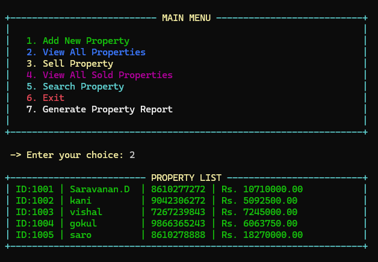
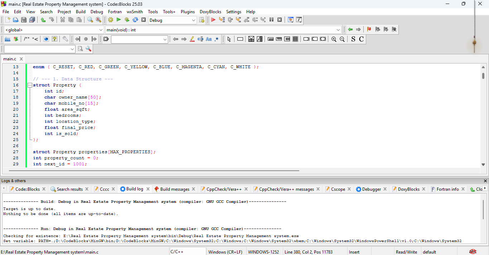

# 🏠 Real Estate Property Management System

<p align="center">
  
</p>

<p align="center">
  <b>A Console-Based Property Management Application Using C</b>
</p>

<p align="center">
  
  
  
</p>

---

## 📸 Project Screenshots

<p align="center">
  
  
</p>

<p align="center">
  
  
</p>

<p align="center">
  
  
</p>

<p align="center">
  
</p>

---

## 📖 About the Project

The Real Estate Property Management System is a menu-driven application developed using the C programming language. It simplifies property registration, property price calculation, property searching, sales management, and report generation through a colorful console interface.

## ✨ Key Features

* 🏠 Add New Property
* 📋 View All Properties
* 💰 Sell Property
* ✅ View All Sold Properties
* 🔍 Search Property
* 📊 Generate Property Report
* 🧮 Automatic Property Price Calculation
* 🛡️ Mobile Number Validation
* 🎨 Colorful Console Interface

## 🛠️ Technologies Used

* C Programming
* GCC Compiler
* Code::Blocks
* Standard C Library
* Windows Console API

## ⚙️ Installation

### Clone Repository

```bash
git clone https://github.com/saravananbass12-tech/REAL-ESTATE-PROPERTY-MANAGEMENT-SYSTEM.git
```

### Open Project

```bash
cd REAL-ESTATE-PROPERTY-MANAGEMENT-SYSTEM
```

### Compile

Replace `main.c` with your actual C source filename.

```bash
gcc main.c -o real_estate
```

### Run

```bash
real_estate.exe
```

## 📊 Main Menu

| Option | Feature                  |
| ------ | ------------------------ |
| 1      | Add New Property         |
| 2      | View All Properties      |
| 3      | Sell Property            |
| 4      | View All Sold Properties |
| 5      | Search Property          |
| 6      | Exit                     |
| 7      | Generate Property Report |

## 👨‍💻 Author

**Saravanan D**

BCA Graduate | Aspiring Software Developer

GitHub: [saravananbass12-tech](https://github.com/saravananbass12-tech)

---

<p align="center">
  ⭐ If you like this project, give it a star!
</p>
