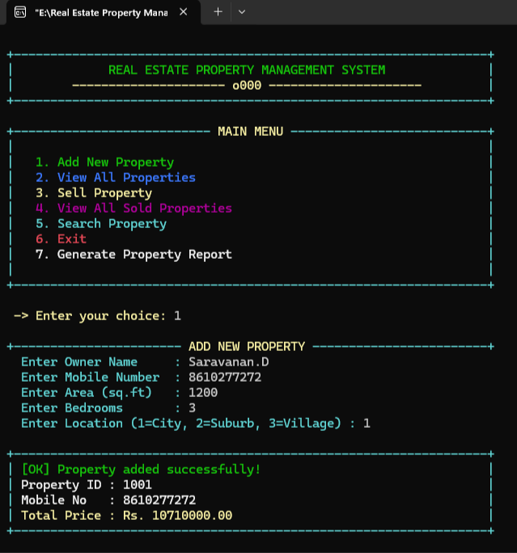
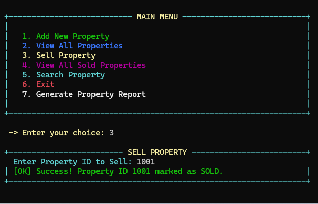
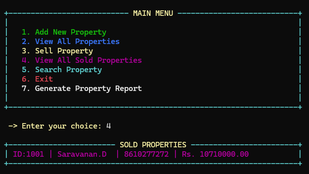
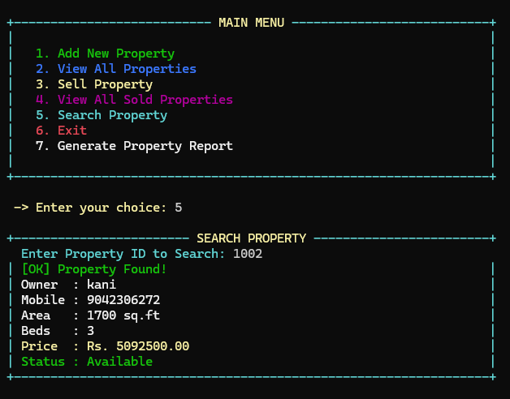
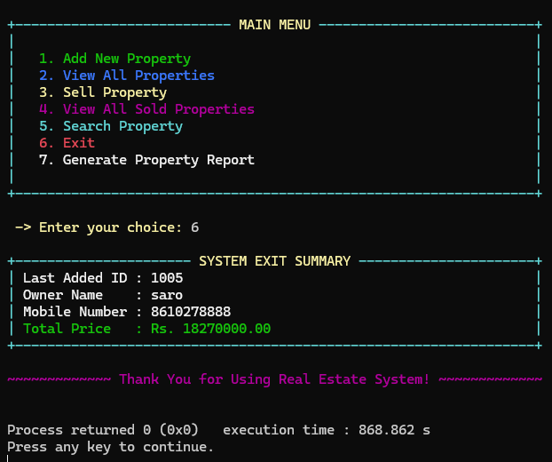

# 🏠 Real Estate Property Management System

### A Console-Based Property Management Application Using C
---

## 🎯 Project Objectives

* Simplify basic property registration and management.
* Calculate property prices automatically.
* Maintain property availability and sales status during a session.
* Search for registered properties using unique property IDs.
* Validate mobile numbers and location selections.
* Generate reports showing registered, available, and sold properties.
* Apply fundamental C programming concepts to a practical application.

---
---

## 🛠️ Technology Stack

| Technology          | Purpose                                           |
| ------------------- | ------------------------------------------------- |
| C Programming       | Application development                           |
| GCC Compiler        | Compiling the C source code                       |
| Code::Blocks        | Development environment                           |
| Standard C Library  | Input, output, string handling, and formatting    |
| Windows Console API | Console text colors on Windows                    |
| ANSI Escape Codes   | Console colors on supported non-Windows terminals |

---

## 📸 Screenshots

Screenshots help users understand the application before downloading or running the source code.

Add your actual console screenshots to the `Screenshot` folder in your repository.

### 1. Main Menu

### 2. Add New Property

### 3. Property List

### 4. Sold Properties

### 5. Search Property

### 6. System Report

**Important:** The image links will work only after the corresponding image files have been uploaded to the `Screenshot` folder. Use the exact filenames and capitalization from your repository.

---

## 🚀 Future Enhancements

The following features could be added in future versions:

* Integrate a MySQL or SQLite database.
* Save property records permanently using file handling.
* Add property update and deletion features.
* Introduce owner and administrator login functionality.
* Add advanced property search by location, price, and area.
* Generate downloadable property reports.
* Add property images and detailed descriptions.
* Develop a graphical user interface or web application.
* Add transaction history and sales reports.

---

## 👨‍💻 Author

**Saravanan D**

BCA Graduate | Aspiring Software Developer

**GitHub:** [saravananbass12-tech](https://github.com/saravananbass12-tech)

**Project Repository:** [Real Estate Property Management System](https://github.com/saravananbass12-tech/REAL-ESTATE-PROPERTY-MANAGEMENT-SYSTEM)

---
